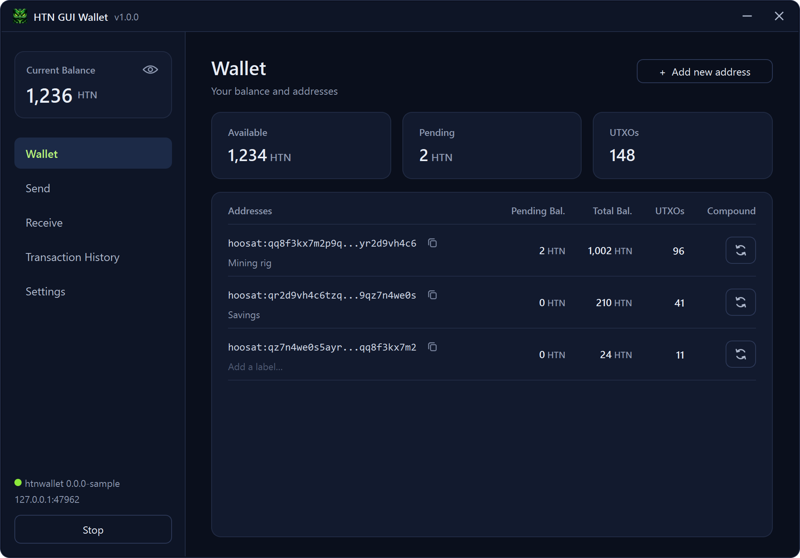
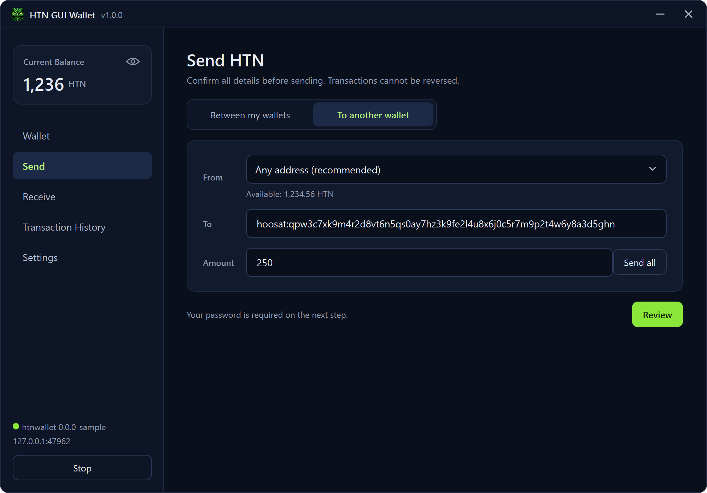
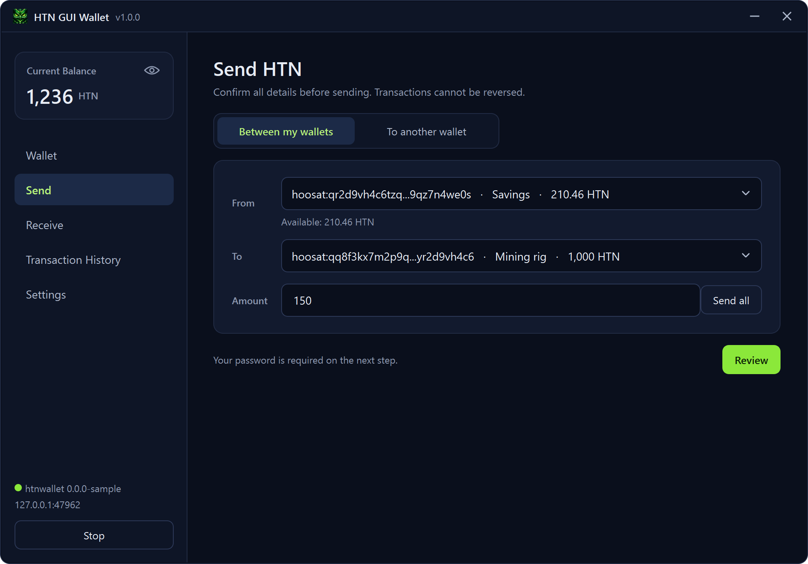
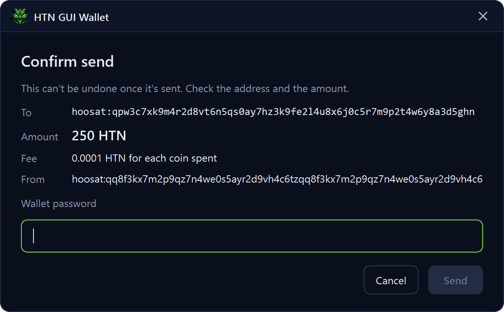
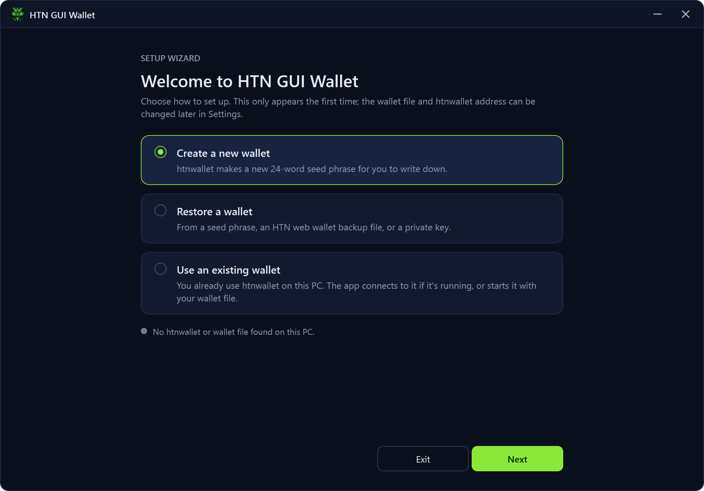
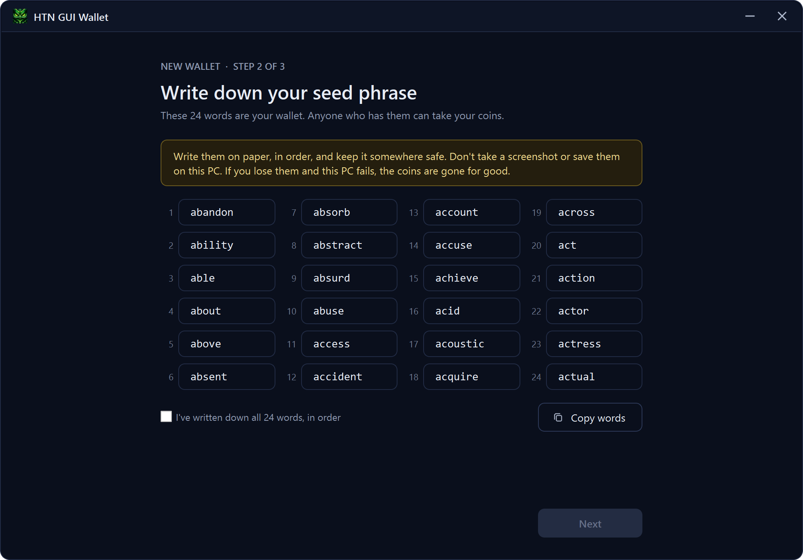

# Hoosat GUI Wallet

A desktop interface for the Hoosat command-line tools. It's a set of forms on top of
`htnwallet` and `htnctl`, and contains no wallet logic of its own. Keys, signing and sending
are all done by `htnwallet`, unmodified.

> **Requires HTND.** This app needs `htnwallet` and `htnctl` from the official Hoosat node software,
> **[HTND](https://github.com/HoosatNetwork/HTND)**, and a Hoosat node to connect to (with
> `--utxoindex` on). Get them from HTND's releases page and put them in the same folder as this app.

Version 1.0.1, for Windows and Linux.

- **Create or restore a wallet** with the Setup Wizard: a new 24-word seed phrase, or restore from a
  seed phrase, an HTN web wallet backup, or a private key.
- **See your balance** per address, with your own labels, and add new addresses.
- **Send** to another wallet, or **transfer between your own addresses**.
- **Auto-compound** an address's coins, and see **transaction history** from the HTN explorer.

Use it at your own risk: see the licence below.

## Screenshots

### Wallet
Your balance, each address with its own label, and one-click compounding.



### Send
Send to another wallet. Every amount is checked against what the address holds.



### Transfer between your addresses
Move coins from one of your addresses to another.



### Confirm before sending
Check the address and amount, then enter your wallet password.



### Creating a wallet
The Setup Wizard opens the first time: create a new wallet, restore one, or use the one you already have.



htnwallet makes the 24-word seed phrase; the app shows it to write down, then checks three of the words.



The pictures use sample data, not a real wallet.

## Privacy and your data

Everything you type into the app stays on your computer. The app has no servers, no accounts,
no tracking and no analytics.

- **Your password, seed phrase and private key are never saved to disk by the app and never
  sent anywhere.** They're handed straight to `htnwallet` on your computer. Only `htnwallet`
  keeps your wallet, in its own encrypted wallet file.
- **What the app saves**, in its settings folder on your computer only: your settings, your
  address labels, a copy of your transaction history, the address and amount of a send while it's
  in progress, and htnwallet's start-up log. None of it contains a password, seed phrase or key.
- **What goes over the internet:**
  - `htnwallet` talks to the Hoosat node you choose in Settings, to read your balance and send
    your transactions. Transactions are public on the Hoosat network.
  - Transaction History reads your addresses' transactions from the HTN explorer's public API
    (EU or NZ, your choice in Settings). Addresses and transactions are public on the network, but the explorer can see
    that one computer asked about these addresses. It's only asked while the Transaction History
    page is open; if you'd rather it wasn't asked at all, don't open that page.
  - Nothing else. There's no update check, and nothing is sent to the app's authors. (The tray
    menu's HTN Explorer links just open the explorer website in your browser.)

Keep in mind:

- **Copy words** puts your seed phrase on the clipboard, where other programs can read it.
  Writing it on paper is safer.
- Some secrets are passed to `htnwallet` on its command line, which other programs on the same
  computer can read while that command runs (see Known limitation below). On Linux that
  includes other users' programs, not just yours.
- **Debug details** in Settings shows the command sent to `htnwallet`, with the password always
  hidden. It's off unless you switch it on.

## How it works

```
This app ──> htnwallet ──> wallet daemon ──> HTND node
        └──> htnctl ─────────────────────────> HTND node
```

- The app starts `htnwallet` and `htnctl` hidden, and only with the commands listed in
  [`core/tools.py`](src/guiwallet/core/tools.py).
- `htnctl` is limited to commands that only read information.
- The user enters the node to use. It must have `--utxoindex` turned on and its RPC port open
  to this computer.

## Running it

Download `htnwallet` and `htnctl` from [HTND](https://github.com/HoosatNetwork/HTND) first.

Put `htnwalletgui-vX.X.X-windows-amd64.exe` (from the [releases page](https://github.com/tjlee92/htn-gui-wallet/releases)) in your HTND folder, beside `htnwallet.exe` and `htnctl.exe`, or choose their
folder in Settings. The app looks only in those two places, never on the system `PATH`.

### On Linux

Unpack `htnwalletgui-vX.X.X-linux-amd64.tar.gz` into your HTND folder, beside `htnwallet` and `htnctl`:

```sh
tar -xzf htnwalletgui-vX.X.X-linux-amd64.tar.gz --strip-components=1 -C /path/to/HTND/bin
```

Then run `./htnwalletgui` from that folder. Run `sh install.sh` once to add it to the
applications menu. It needs Ubuntu 22.04, Debian 12, Mint 21, Fedora 36 or newer (x86-64).

Settings are kept in `~/.config/guiwallet`, and the wallet file is htnwallet's usual
`~/.htnwallet/hoosat-mainnet/keys.json`. Desktops without a tray area (GNOME without an extension)
simply close the app when the window is closed.

## Building it

You need Windows and Python 3.13.

```powershell
powershell -ExecutionPolicy Bypass -File build.ps1
```

This creates a private `.venv`, installs the pinned dependencies, runs the tests, and produces
`dist\htnwalletgui-v<version>-windows-amd64.exe`.

For Linux, with Docker installed (from Linux, or from Windows with Docker Desktop and Git Bash):

```sh
sh build-linux.sh
```

This builds inside Ubuntu 22.04, runs the tests there, and produces
`dist/htnwalletgui-v<version>-linux-amd64.tar.gz`.

## Developing

```powershell
py -3.13 -m venv .venv
.venv\Scripts\python -m pip install --require-hashes -r requirements.txt -r requirements-dev.txt
.venv\Scripts\python -m pytest
$env:PYTHONPATH = "src"; .venv\Scripts\python -m guiwallet
```

To change a dependency, edit `requirements.in` or `requirements-dev.in`, then regenerate the
pinned files with [pip-tools](https://pip-tools.readthedocs.io/):

```powershell
pip-compile --generate-hashes --allow-unsafe requirements.in
pip-compile --generate-hashes --allow-unsafe requirements-dev.in
```

## Layout

| Path | What's there |
|---|---|
| `src/guiwallet/core/` | Logic with no interface code: running tools, checking input, reading wallet output, settings |
| `src/guiwallet/ui/` | The window and screens |
| `tests/` | Automated tests |
| `build.ps1`, `packaging/` | Building the `.exe` |

## Security rules for contributors

- Never log or display command arguments, or the output of `dump-unencrypted-data`. They can
  contain passwords and recovery phrases.
- Never store a password or recovery phrase.
- Start other programs only through `core/tools.py`, and never through a shell.
- Add an `htnctl` command to the allowed list only if it can't change the node.

## Known limitation

`htnwallet` can only ask for secrets in a terminal window, so the app has to pass them on its
command line instead. Anything that can see the command lines of running programs can read them
while the command runs:

- **The wallet password**, during a send (a few seconds), and **for as long as an auto-compound
  keeps running**, which can be hours or days. Also while the Setup Wizard creates or restores a
  wallet.
- **The private key**, when restoring from a private key, and **the backup's password**, when
  restoring from a web wallet backup file. Both only for the moment the restore runs. (Seed
  phrases are never passed this way: they go to `htnwallet` directly.)

Who can see them:

- **Windows:** other programs running under your account, and programs running as
  administrator. Security or auditing tools that record command lines (for example Windows
  process auditing, Sysmon, or some antivirus software) may also save them in their logs.
- **Linux:** any user on the computer, not just you, can read other programs' command lines by
  default.

On a computer only you use, with no malware on it, this isn't a practical risk. On a shared
computer, don't leave auto-compound running, and restore from a private key or backup file on a
computer only you use.

## Licence

Copyright (C) 2026 the Hoosat GUI Wallet contributors.

This program is free software: you can redistribute it and/or modify it under the terms of the
GNU General Public License, version 3 or (at your option) any later version. It comes with
ABSOLUTELY NO WARRANTY. See [LICENSE](LICENSE) for the full text.

The built `.exe` includes third-party libraries under their own licences; see
[THIRD-PARTY-NOTICES.md](THIRD-PARTY-NOTICES.md).
